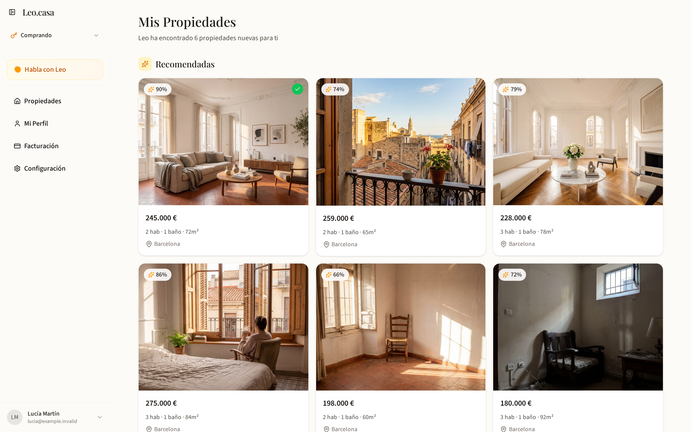

# Home Matching

Home Matching is a property search app for people choosing a home in Spain, and the agents helping them. It brings a household’s routines, budget and priorities into the search: daylight, working from home, outdoor space, accessibility and neighborhood fit.

[Website](https://atelierneyra.com/home-matching) · [Open app](https://preview.atelierneyra.com/?project=home-matching) · [Documentation](https://docs.atelierneyra.com/home-matching/overview/)

Property analysis is shared across searches. Changing a household’s priorities reranks the same analysis through deterministic scoring. The source includes the original intake, recommendations, property reports, maps, voice flows, data adapters and ingestion tools.



The example uses fictional purchase homes and actual deterministic scores.

## Run the app

Use Node 22.18 or later in the Node 22 line, Python 3.10+, and the repository root:

```sh
git clone https://github.com/latintzar/home-matching.git
cd home-matching
npm ci
python3 tools/sample-app.py build
python3 tools/sample-app.py start
```

Open **http://127.0.0.1:3000**. The original Leo.casa workspace opens with eight fictional purchase homes and recovered, originally generated property images. Browse homes, save favorites, add viewing notes and edit the household profile. The original deterministic scorer reranks stored property and neighborhood evidence.

Each browser has a private local workspace. SQLite state lives outside the checkout. [Native workspace](docs/native-workspace.md) explains the data, storage, routes and deployment; [Setup](docs/setup.md) covers recipient-owned providers. The smaller `starter/` scene and `tools/first-match.mjs` remain useful scoring examples.

## Build with it

- [Guide](docs/guide.md): first result, changes and next steps.
- [Setup](docs/setup.md): recipient-owned private configuration and full-app dependencies.
- [Workflows](docs/workflows.md): property analysis, household fit, voice and location.
- [Architecture](docs/architecture.md): modules, storage contracts and execution boundaries.
- [Decisions](docs/decisions.md): original choices and extraction tradeoffs.
- [Source reference](docs/reference/README.md): modules, functions and machine-readable symbols.
- [Release status](RELEASE-STATUS.md): tested scope and integration acceptance.
- [Original plans](docs/plans/P0_INDEX.md): retained historical product specifications.

Original code: MIT, copyright Peter Neyra. [Third-party notices](THIRD-PARTY-NOTICES.md) cover dependencies and fonts. [Provenance](docs/provenance.md) records the source pin, authored examples and retained historical experiments.

[made by atelier neyra](https://atelierneyra.com)
