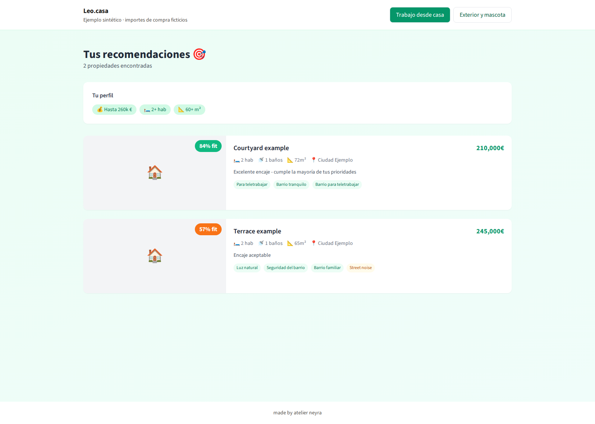

# Home matching for buyers and renters

Leo.casa is a property search app for people choosing a home in Spain, and the agents helping them. It brings a household’s routines, budget and priorities into the search: daylight, working from home, outdoor space, accessibility and neighborhood fit.

Property analysis is shared across searches. Changing a household’s priorities reranks the same analysis through deterministic scoring. The source includes the original intake, recommendations, property reports, maps, voice flows, data adapters and ingestion tools.



The example uses fictional purchase homes and actual deterministic scores.

## First result

Use Node 22.18 or later in the Node 22 line:

```sh
git clone https://github.com/latintzar/home-matching.git
cd home-matching
node --experimental-strip-types tools/first-match.mjs
node --experimental-strip-types --test tests/first-match.test.mjs
```

The original scorer ranks the courtyard home **84** for a buyer working from home. Choosing outdoor space and a pet makes the terrace home rank first at **90**. A house-share fails the profile’s dealbreaker. A private receipt records the inputs, source and results.

Open the original recommendation scene:

```sh
cd starter
npm ci
npm run dev
```

Visit **http://127.0.0.1:3000** and switch between the two profiles. The example runs locally with authored listings and analysis scores. The full application’s provider setup is described separately.

## Build with it

- [Guide](docs/guide.md): first result, changes and next steps.
- [Setup](docs/setup.md): recipient-owned private configuration and full-app dependencies.
- [Workflows](docs/workflows.md): property analysis, household fit, voice and location.
- [Architecture](docs/architecture.md): modules, storage contracts and execution boundaries.
- [Decisions](docs/decisions.md): original choices and extraction tradeoffs.
- [Source reference](docs/reference/README.md): modules, functions and machine-readable symbols.
- [Release status](RELEASE-STATUS.md): tested scope and integration acceptance.
- [Original plans](docs/plans/P0_INDEX.md): retained historical product specifications.

Original code: MIT, copyright Peter Neyra. [Third-party notices](THIRD-PARTY-NOTICES.md) cover dependencies and fonts. [Provenance](docs/provenance.md) records the source pin, authored examples and retained historical experiments.

[made by atelier neyra](https://atelierneyra.com)
