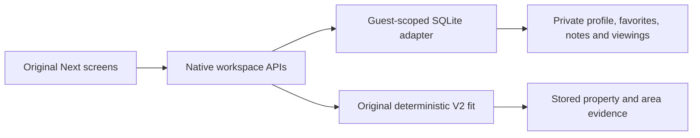

# Native workspace

The root Next application runs the original Leo.casa screens with a local, per-browser workspace. This is the same source and build used by the hosted preview.

## First result

Follow [Setup](setup.md). The first visit opens `/dashboard`; `/recommendations`, `/recommend`, `/property/1000000001`, `/saved`, `/viewings`, `/profile` and `/catalogue` use the same listings and storage. Add a property note, save a home, then edit the household's priorities. Reloading preserves the current browser's edits.

Eight authored purchase listings use fictional prices, dimensions and location facts. Their WPA-shaped and neighborhood evidence is authored. Twenty-three originally generated property assets are recovered from the pinned source and matched to its retained generation prompts; [image provenance](assets/generated-property-images.json) records hashes. They illustrate the fictional catalogue. Raw agency listings, customer records and private analysis exports remain outside the package.

## Flow

The browser calls real same-origin APIs. The server uses the retained query shape through `src/lib/sample/query.mjs`; `store.mjs` commits state to SQLite. `seed.mjs` owns the immutable catalogue/evidence. `recommend.ts` runs the existing prefilter and `fitScoringV2.ts` calculations. `profileFit.ts` and `profileStorage.ts` share the original profile conversions across real and local modes. Dashboard, recommendations and property views show the same deterministic scores.

## Identity and persistence

Middleware creates an opaque HttpOnly, SameSite=Lax guest cookie scoped to the app prefix; HTTPS sets Secure. Public user IDs are derived separately. Every state query is scoped to that guest, including native joins. Mutations check same-origin request context and stream a body cap of32KiB before route JSON parsing. Catalogue writes are rejected. Private state uses a mode-0700 directory and mode-0600 SQLite file outside source and static roots; transactions use `BEGIN IMMEDIATE`, WAL and a busy timeout.

The adapter bounds queries, rows and state: 24,000 serialized query characters, 64,000 state characters, 128 rows per mutable table, ten insert rows, 100 returned rows and 512 guests with a twelve-hour lifetime. These are local-preview bounds; shared public operation also needs an ingress request rate policy. `DELETE /api/sample/session` resets the current guest's workspace. Browser-session cookies and state expiry make this a temporary workspace rather than an account service.

## Deployment

`tools/sample-app.py build` creates `.next/standalone` with public/static files, launcher and a mode/base-path receipt. Start the artifact with its recorded prefix and an external state path. A proxy preserves the complete prefix, including API and asset paths. Forward the trusted public Host/protocol. Node 22's built-in SQLite is experimental; use the tested Node 22.18+ line. Python is only the safe process launcher.

Sample mode clears ambient credentials and cloud profiles; it selects local storage, blocks unconfigured provider routes in middleware, and retains the original provider implementations for recipient configuration. Optional Supabase/Google/Stripe SDKs initialize at feature use instead of module import. Actual model analysis, voice, acquired listings, measured commute, billing and cloud-account setup require recipient services. Their successful operation is separate from cached matching.

## Extraction decisions · 2026-10-28

These are retrospective choices for the public derivative of `puedo_casa` at `d461e9556f09ad526030376ab58643298e3a1fc8`:

- Preserve the full original UI and API call shapes. Local storage implements the retained query contract, making first use and provider commissioning separate operations.
- Share immutable analysis and recompute deterministic fit per household. This preserves the original cache-to-fit design and avoids running analysis on each preference change.
- Persist guest edits outside source. SQLite provides atomic updates and cross-process persistence with a compact standalone runtime.
- Bridge the two retained profile field generations at the storage boundary. Both native profile edits and the original intake update coherent household preferences.
- Defer optional SDK construction until feature use. Real adapters retain their recipient-account configuration and original algorithms while a source build runs without cloud credentials.
- Preserve generated source media with prompt/hash provenance. Authored listings and evidence make the running workspace redistributable and reproducible.

## Verification

Fresh root `npm ci`, complete Next build and TypeScript check pass. Seven storage tests cover isolation, persistence, readonly catalogue, bounds and concurrent processes; two lazy-resource tests cover initialization/ownership; two native-fit tests exercise the original scorer; two request tests cover streamed/multibyte body limits and cookie renewal. Actual Chromium checks eight native routes at 1600 and 390 pixels and exercises saves, notes, profile changes, guest isolation, cookie scope, CSRF and disabled provider paths. Provider requests remain zero during this proof.
