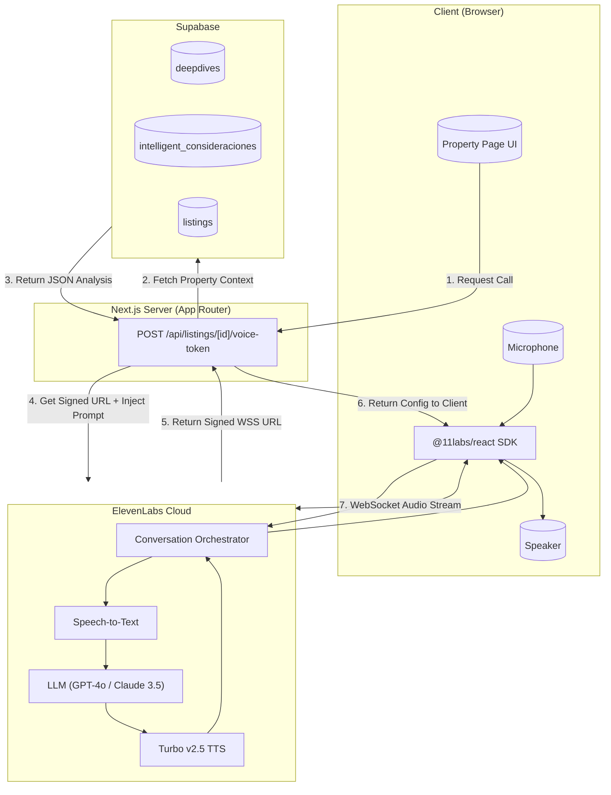

# ElevenLabs Conversational Agent Architecture for Puedo Casa

## Overview

This document outlines the architecture for integrating a real-time **Conversational Voice Agent** into the Puedo Casa platform. This feature allows users (investors/agencies) to "discuss" a property with an AI expert that has full context of the renovation analysis, ROI, and specific risks.

We leverage **ElevenLabs Conversational AI** to handle the complexity of Speech-to-Text (STT), LLM reasoning, and Text-to-Speech (TTS) in a single low-latency pipeline, while injecting our proprietary Supabase data as context.

## High-Level Architecture

The system connects the frontend browser directly to ElevenLabs via a WebSocket, authenticated and configured by our Next.js backend.



## Data Flow Strategy: "Context Injection"

Instead of using complex RAG (Retrieval-Augmented Generation) during the call, we **inject** the relevant property analysis directly into the Agent's system prompt at the moment the session starts.

### 1. The Context Payload
We aggregate data from multiple tables to form a concise "Property Brief":

```typescript
interface PropertyContext {
  address: string;
  listing_price: number;
  renovation_cost_optimo: number;
  estimated_roi: number;
  key_features: string[];
  top_risks: string[]; // Derived from intelligent_consideraciones
  investment_verdict: string; // "Buy", "Pass", "Negotiate"
}
```

### 2. The System Prompt
This payload is formatted into natural language instructions for the LLM:

> "You are a savvy real estate investment analyst. You are discussing the property at **[Address]**.
>
> **Financials:**
> - Price: €[Price]
> - Renovation: €[Cost]
> - ROI: [ROI]%
>
> **Critical Risks:**
> - [Risk 1]
> - [Risk 2]
>
> **Your Goal:**
> Answer the investor's questions confidently. If the ROI is below 10%, recommend negotiating harder. Be concise."

## Implementation Plan

### Phase 1: Environment & Setup
1.  **ElevenLabs Account**:
    *   Create a new Agent in the ElevenLabs Dashboard.
    *   Configure the default "Persona" (Voice, broad instructions).
    *   Obtain `AGENT_ID` and `ELEVENLABS_API_KEY`.
2.  **Dependencies**:
    *   `npm install @11labs/react elevenlabs`

### Phase 2: Backend (The "Handshake")
Create a Next.js API route to secure the connection and inject context.

**File:** `src/app/api/listings/[id]/voice-token/route.ts`

- **Responsibility**:
    1.  Verify user authentication (Clerk/Supabase).
    2.  Fetch `deepdives` and `intelligent_consideraciones` for the `listing_id`.
    3.  Construct the `dynamic_prompt`.
    4.  Call `elevenlabs.conversationalAi.getSignedUrl()` with the prompt override.
    5.  Return the `signedUrl` to the client.

### Phase 3: Frontend (The UI)
Create a reusable component to manage the call state.

**File:** `src/components/voice/PropertyVoiceAgent.tsx`

- **Responsibility**:
    1.  Use `useConversation` hook from `@11labs/react`.
    2.  Fetch the token from our API.
    3.  Handle `startSession`, `endSession`.
    4.  Visualize state: `disconnected` | `connecting` | `connected` | `speaking`.
    5.  Handle microphone permissions errors gracefully.

### Phase 4: Integration
- Add the `PropertyVoiceAgent` component to the `DeepDivePage` (Mock V2 UI).
- Ensure it only appears for properties with `pipeline_stage = 'complete'`.

## Technical Considerations

### Latency
- The **WebSocket connection** ensures audio is streamed bi-directionally.
- **Turbo v2.5** model provides sub-500ms response times.

### Cost Control
- Calls are billed by ElevenLabs based on minutes.
- **Limit Session Duration**: Configure a max duration (e.g., 5 minutes) in the Agent settings or frontend to prevent runaway costs.

### Security
- **Ephemeral Tokens**: The `signedUrl` is valid for a single session and expires quickly.
- **Server-Side Keys**: The `ELEVENLABS_API_KEY` is never exposed to the client; it stays in `process.env`.

## Future Enhancements (Phase 2)
- **Tool Usage**: Give the agent tools to "save" notes to the database (e.g., "Remind me to check the roof").
- **Multimodal**: In the future, stream the screen context so the agent "sees" the specific photo the user is looking at (ElevenLabs is adding vision capabilities).

