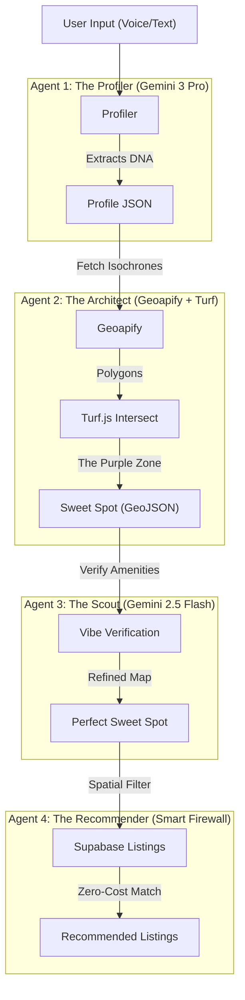

# Lifestyle Matching Engine: The "Smart Firewall" Architecture

**Last Updated**: 2025-11-23
**Status**: Production-Ready
**Core Philosophy**: "Generate the Map first, then find the Listings."

---

## 1. The Pivot: Why We Changed Everything
We initially designed this using **H3 Hex Grids** and **Google Maps Route Matrix API**.
*   **The Problem**: Calculating commute times for 2,000 hexes cost ~$5.00 per user session.
*   **The Solution**: We pivoted to **Geoapify Isoline API** (returns Polygons directly) + **Turf.js** (Local Intersection).
*   **The Result**: Cost dropped from **$5.00** to **$0.00** (Free Tier).

---

## 2. Architecture Overview

The engine consists of four autonomous agents working in sequence:



---

## 3. Component Detail

### Node 1: The Profiler ("The Psychologist")
*   **Model**: `gemini-3-pro-preview`
*   **Role**: Analyzes unstructured input ("I want to be near the beach but not too touristy") to extract structured **Anchors** and **Vibe Constraints**.
*   **Output**:
    ```json
    {
      "anchors": [
        { "name": "Office (Atocha)", "lat": 40.4, "lng": -3.6, "max_time": 20, "mode": "transit" },
        { "name": "Gym", "type": "search", "query": "Crossfit", "dependency": "10m walk" }
      ],
      "vibe": ["quiet", "local"]
    }
    ```

### Node 2: The Architect ("The Builder")
*   **Engine**: `src/lib/lifestyle/orchestrator.ts`
*   **Tools**: 
    *   **Geoapify Isoline API**: Generates travel-time polygons (e.g., "Area within 20 mins transit of Atocha").
    *   **Turf.js**: Calculates the mathematical intersection of all polygons locally.
*   **Logic**: "The Venn Diagram of Life". The intersection of *all* anchor isochrones is the only physically possible place the user can live.
*   **Output**: A `MultiPolygon` GeoJSON representing the "Sweet Spot".

### Node 3: The Scout ("The Vibe Checker")
*   **Engine**: `src/lib/lifestyle/ai-scout.ts`
*   **Tools**: 
    *   **ScrapingDog**: Searches Google Maps for amenities inside the Sweet Spot.
    *   **Gemini 2.5 Flash**: Verifies if those amenities match the "Vibe" (e.g., "Is 'McFit' a 'luxury gym'?" -> No).
*   **Logic**: "Substitutive Search". We find generic candidates (e.g., any gym) within the Sweet Spot and verify them. If valid, they stay.

### Node 4: The Recommender ("The Smart Firewall") 💰 **ZERO COST**
*   **Endpoint**: `/api/lifestyle/recommendations`
*   **Technique**: **Point-in-Polygon (Spatial Filtering)**.
*   **Mechanism**:
    1.  We have 10,000 listings in the database with `lat/lng`.
    2.  We do **NOT** run the expensive AI pipeline on them yet.
    3.  We take the **Sweet Spot Polygon** (from Node 2).
    4.  We run `turf.booleanPointInPolygon(listing, sweetSpot)`.
    5.  This instantly filters 10,000 listings down to the **50** that are geographically perfect.
*   **Benefit**: We only incur AI costs (Text Analysis, Photo Clustering) on the 50 winners, not the 9,950 losers.

---

## 4. API Reference

### `POST /api/lifestyle/recommendations`

**Input:**
```json
{
  "sweetSpot": { "type": "Feature", "geometry": { ... } },
  "filters": {
    "minPrice": 200000,
    "maxPrice": 500000,
    "city": "Madrid"
  }
}
```

**Process:**
1.  **DB Fetch**: Fetches active listings (id, price, lat, lng) matching price/city.
2.  **Spatial Filter**: Runs Turf.js locally to check containment.
3.  **Response**: Returns matching listing IDs + metadata.

**Output:**
```json
{
  "success": true,
  "count": 12,
  "listings": [
    { "id": 101, "title": "Piso en Retiro", "price": 450000, "match_type": "sweet_spot" }
  ]
}
```

---

## 5. Cost Analysis

| Action | Service | Cost |
| :--- | :--- | :--- |
| **Profile Analysis** | Gemini 3 Pro | $0.01 |
| **Map Generation** | Geoapify | **$0.00** (Free Tier) |
| **Recommendation** | Turf.js (Local) | **$0.00** |
| **Total per Search** | | **~$0.01** |

*Compare to Legacy Google Maps Approach: ~$5.00 - $10.00 per search.*
