# Pipeline Flow Documentation

**Last Updated**: 2025-01-27  
**Source**: Generated from actual endpoint code analysis

## 📋 Pipeline Overview

This document describes the complete pipeline flow from URL input to published Deep Dive, including all API endpoints, their dependencies, and **exact database table inputs/outputs** extracted from the actual code.

---

## 🔗 Complete Pipeline Flow: Scraping → R3 (With Exact Table Dependencies)

```mermaid
flowchart TB
  subgraph Scraping["1. Scraping Phase"]
    S["S) Scraping<br/>📥 READ: (none - creates new)<br/>📤 WRITE: listings<br/>  - id, title, price_eur, scraped_data<br/>📤 WRITE: listing_photos<br/>  - listing_id, url, display_order<br/>📤 STORAGE: property-images/{id}/before/"]
  end

  subgraph TextAnalysis["2. Text Analysis Pipeline"]
    A["A) Facts Extraction<br/>📥 READ: listings<br/>  - scraped_data (description, roomsAndAmenities, additionalFeatures)<br/>  - price_eur<br/>📤 WRITE: text_analysis_results<br/>  - listing_id, phase: 'a_facts'<br/>  - results: {claims: []}"]
    B1["B1) Categorization<br/>📥 READ: text_analysis_results<br/>  - phase: 'a_facts'<br/>  - results.claims<br/>📤 WRITE: text_analysis_results<br/>  - phase: 'b1_categorization'<br/>  - results: {categorization: {categories, unassigned_claim_ids}}"]
    B2["B2) Merge Categories<br/>📥 READ: text_analysis_results<br/>  - phase: 'b1_categorization'<br/>  - results.categorization<br/>📤 WRITE: text_analysis_results<br/>  - phase: 'b2_merge'<br/>  - results: {mergedCategories}"]
    B3["B3) Snippets<br/>📥 READ: text_analysis_results<br/>  - phase: 'b2_merge' (mergedCategories)<br/>  - phase: 'a_facts' (claims)<br/>📤 WRITE: text_analysis_results<br/>  - phase: 'b3_snippets'<br/>  - results: {categorySnippets}"]
    C["C) Unknowns<br/>📥 READ: text_analysis_results<br/>  - phase: 'a_facts' (claims)<br/>  - phase: 'b2_merge' (mergedCategories)<br/>📥 READ: listings<br/>  - scraped_data (areas, bedrooms, bathrooms, additionalFeatures)<br/>📤 WRITE: text_analysis_results<br/>  - phase: 'c_unknowns'<br/>  - results: {categoryUnknowns}"]
  end

  subgraph PhotoAnalysis["3. Photo Analysis Pipeline"]
    D["D) Auto Photo Clustering<br/>📥 READ: listing_photos<br/>📤 WRITE: manual_photo_clusters<br/>  - listing_id, cluster_name, photo_urls[], display_order<br/>📤 WRITE: auto_photo_clusters<br/>  - listing_id, cluster_name, photo_indices[]<br/>📤 WRITE: auto_clustering_test_runs<br/>  - stage4_result (visibility_mappings)<br/>📤 WRITE: manual_photo_clusters<br/>  - visibility_mappings (from Stage 4)"]
    F3["F3) Whole-Property Analysis<br/>📥 READ: listing_photos<br/>  - url<br/>📥 READ: text_analysis_results<br/>  - phase: 'a_facts'<br/>📥 READ: listings<br/>📤 WRITE: whole_property_analysis<br/>  - listing_id<br/>  - analysis_data: {structure, finishes, lighting, notable_issues, strengths}"]
    RoomByRoom["Room-by-Room Analysis<br/>📥 READ: manual_photo_clusters<br/>  - id, cluster_name, photo_urls[]<br/>📥 READ: listings<br/>  - id, title, scraped_data<br/>📤 WRITE: room_analyses<br/>  - analysis_data: RoomAnalysis[]<br/>  (array of room analysis objects)"]
  end

  subgraph GoogleSearch["4. Google Search Pipeline"]
    G["G) Analysis Google Search<br/>📥 READ: text_analysis_results<br/>  - phase: 'b3_snippets'<br/>  - phase: 'c_unknowns'<br/>📥 READ: listings<br/>📥 READ: room_analyses (optional)<br/>  - unified_home_layout_json<br/>📥 READ: whole_property_analysis (optional)<br/>  - analysis_data<br/>📥 READ: room_analyses (optional)<br/>  - analysis_data<br/>📤 WRITE: analysis_search_results<br/>  - listing_id, query, url, title, snippet, display_link, rank, metadata<br/>📤 WRITE: analysis_curated_results<br/>  - listing_id, category, summary, key_points[], representative_snippets[], sources_used[], confidence_level"]
  end

  subgraph Integrated["5. Integrated Diagnostic"]
    H["H) Integrated Diagnostic<br/>📥 READ: text_analysis_results<br/>  - phase: 'b3_snippets'<br/>  - phase: 'c_unknowns'<br/>📥 READ: whole_property_analysis<br/>  - analysis_data<br/>📥 READ: room_analyses<br/>  - analysis_data (RoomAnalysis[])<br/>  - room_layout_json<br/>  - unified_home_layout_json<br/>📥 READ: listing_photos<br/>📥 READ: listings<br/>📥 READ: analysis_curated_results (optional)<br/>📤 WRITE: text_analysis_results<br/>  - phase: 'integrated_diagnostic'<br/>  - results: {diagnostic_report: {}}"]
  end

  subgraph TierIdeation["6. Tier Ideation Pipeline"]
    T1["T1) Group & Catalog<br/>📥 READ: room_analyses<br/>  - unified_home_layout_json<br/>  - room_layout_json (optional)<br/>  - analysis_data (optional)<br/>📤 WRITE: room_families<br/>  - listing_id, family_id, family_name, room_ids[], rationale"]
    T1_5["T1.5) Tier Budgeting<br/>📥 READ: listings<br/>  - price_eur, city, region, scraped_data<br/>📥 READ: text_analysis_results<br/>  - phase: 'integrated_diagnostic'<br/>📥 READ: whole_property_analysis<br/>  - analysis_data<br/>📤 WRITE: tier_budgeting<br/>  - listing_id<br/>  - budgeting_data: {estandar: {min_eur, max_eur, rationale}, optimo: {...}, plus: {...}, property_value_eur, renovation_percentage_of_value}"]
    T2["T2) Tier Ideation<br/>📥 READ: text_analysis_results<br/>  - phase: 'integrated_diagnostic'<br/>📥 READ: tier_budgeting<br/>  - budgeting_data<br/>📥 READ: room_families<br/>📥 READ: listings<br/>📤 WRITE: tier_philosophies<br/>  - listing_id<br/>  - philosophies: {estandar: {intent, quality_band, constraints[]}, optimo: {...}, plus: {...}}"]
    T2_5["T2.5) Tier Style Direction<br/>📥 READ: tier_philosophies<br/>  - philosophies<br/>📥 READ: manual_photo_clusters<br/>  - cluster_name, room_type, photo_urls[]<br/>📥 READ: listings<br/>  - title, price_eur, sqm, property_type, city, region, scraped_data<br/>📥 READ: room_analyses<br/>  - unified_home_layout_json<br/>📤 WRITE: style_direction<br/>  - listing_id<br/>  - direction_data: {baseline?: {...}, tiers: {estandar: {...}, optimo: {...}, plus: {...}}}"]
    T3["T3) Apply to Groups<br/>📥 READ: tier_philosophies<br/>  - philosophies<br/>📥 READ: style_direction<br/>  - direction_data.tiers<br/>📥 READ: room_families<br/>📥 READ: room_analyses<br/>  - unified_home_layout_json<br/>📤 WRITE: group_tier_directives<br/>  - listing_id, tier, family_id<br/>  - directives: {changes[], rationale, examples[]}"]
    T4["T4) Decide Elements<br/>📥 READ: e2_element_mapping<br/>📥 READ: group_tier_directives<br/>  - tier (filtered)<br/>📥 READ: tier_philosophies<br/>📥 READ: style_direction<br/>📥 READ: room_families<br/>📥 READ: e2_tier_target_states (for progression check)<br/>📥 READ: room_analyses<br/>  - unified_home_layout_json<br/>📤 WRITE: e2_tier_target_states<br/>  - listing_id, tier, room_id<br/>  - target_state: {room_id, room_name, elements: [{element_id, action, details, reason}]}"]
    T5["T5) Cohesion<br/>📥 READ: e2_tier_target_states<br/>  - tier (filtered)<br/>📥 READ: e2_after_layouts (optional)<br/>📥 READ: room_analyses<br/>  - unified_home_layout_json<br/>📥 READ: room_families<br/>📤 WRITE: cohesion_notes<br/>  - listing_id, tier<br/>  - cohesion: {tier_unity, material_consistency, color_harmony, style_coherence, progression_consistency}<br/>  - consistency_corrections[]"]
    T5_5["T5.5) Apply Cohesion Corrections<br/>📥 READ: e2_tier_target_states<br/>  - tier (filtered)<br/>📥 READ: cohesion_notes<br/>  - tier (filtered)<br/>  - cohesion, consistency_corrections<br/>📤 WRITE: e2_tier_target_states (UPDATED)<br/>  - target_state (updated with corrections)"]
  end

  subgraph Renovation["7. Renovation Pipeline"]
    I["I) Seed Scope from Tiers<br/>📥 READ: e2_tier_target_states<br/>📥 READ: group_tier_directives<br/>📥 READ: cohesion_notes<br/>📥 READ: room_analyses<br/>  - unified_home_layout_json<br/>📥 READ: listing_photos<br/>📥 READ: manual_photo_clusters<br/>📥 READ: listings<br/>📤 WRITE: renovation_scope_reports<br/>  - listing_id<br/>  - report_data: {tiers: {estandar: {work_items[]}, optimo: {...}, plus: {...}}}"]
    J["J) Renovation Google Search<br/>📥 READ: renovation_scope_reports<br/>  - report_data<br/>📥 READ: listings<br/>📤 WRITE: renovation_search_results<br/>📤 WRITE: renovation_research_results<br/>  - listing_id, category (costs_%, timings_%, permits_%, etc.)<br/>  - report_data"]
    K["K) Pricing<br/>📥 READ: renovation_scope_reports<br/>  - report_data<br/>📥 READ: renovation_research_results<br/>  - category: 'costs_%'<br/>📥 READ: listings<br/>📤 WRITE: renovation_pricing_reports<br/>  - listing_id<br/>  - report_data: {tiers: {estandar: {work_items: [{cost_low_eur, cost_high_eur}]}, ...}}"]
    L["L) Timeline<br/>📥 READ: renovation_scope_reports<br/>  - report_data<br/>📥 READ: renovation_research_results<br/>  - category: 'timings_%'<br/>📥 READ: renovation_pricing_reports<br/>📥 READ: listings<br/>📤 WRITE: renovation_timeline_reports<br/>  - listing_id<br/>  - report_data: {tiers: {estandar: {phases[]}, ...}}"]
    M["M) Permits<br/>📥 READ: renovation_scope_reports<br/>  - report_data<br/>📥 READ: renovation_research_results<br/>  - category: 'permits_%'<br/>📥 READ: listings<br/>📤 WRITE: renovation_permits_reports<br/>  - listing_id<br/>  - report_data: {tiers: {estandar: {permits[]}, ...}}"]
    N["N) Finalize Tiers<br/>📥 READ: renovation_scope_reports<br/>  - report_data<br/>📥 READ: renovation_pricing_reports<br/>  - report_data<br/>📥 READ: renovation_timeline_reports<br/>  - report_data<br/>📥 READ: renovation_permits_reports<br/>  - report_data<br/>📤 WRITE: final_renovation_scope<br/>  - listing_id<br/>  - scope_data: {tiers: {estandar: {total_estimate_range_eur[], timeline, permits[]}, ...}}"]
  end

  subgraph BudgetCalibration["8. Budget Calibration"]
    T6["T6) Budget Calibration (Optional)<br/>📥 READ: final_renovation_scope<br/>  - scope_data<br/>📥 READ: tier_budgeting<br/>  - budgeting_data<br/>📥 READ: renovation_research_results<br/>  - category: 'costs_%'<br/>📥 READ: tier_philosophies<br/>📥 READ: style_direction<br/>📥 READ: cohesion_notes<br/>📥 READ: room_families<br/>📥 READ: listings<br/>📤 WRITE: final_renovation_scope_calibrated<br/>  - listing_id<br/>  - scope_data (revised with budget adjustments)"]
    T6_5["T6.5) Iterate Element Decisions<br/>📥 READ: final_renovation_scope_calibrated (if T6 run)<br/>  OR final_renovation_scope (if T6 skipped)<br/>📥 READ: e2_tier_target_states<br/>  - tier (filtered)<br/>📥 READ: room_analyses<br/>  - unified_home_layout_json<br/>📤 WRITE: e2_tier_target_states (UPDATED)<br/>  - target_state (updated based on budget-calibrated scope)"]
  end

  subgraph R_Pipeline["9. R Pipeline: After Image Generation (to R3)"]
    F0["F0) Furniture Removal<br/>📥 READ: manual_photo_clusters<br/>  - cluster_name, photo_urls[]<br/>📥 READ: listing_photos<br/>  - url<br/>📤 WRITE: listing_photos_furniture_free<br/>  - listing_id, original_photo_url, furniture_free_url<br/>📤 STORAGE: property-images/{id}/furniture-free/"]
    R1["R1) Select Room Images<br/>📥 READ: manual_photo_clusters<br/>  - id, cluster_name, photo_urls[], selected_photo_url<br/>📥 READ: listing_photos_furniture_free<br/>📤 WRITE: manual_photo_clusters (UPDATED)<br/>  - selected_photo_url"]
    R2a["R2a) Describe Room Images<br/>📥 READ: manual_photo_clusters<br/>  - selected_photo_url<br/>📥 READ: listing_photos_furniture_free<br/>  - furniture_free_url<br/>📥 READ: room_analyses<br/>  - unified_home_layout_json<br/>📤 WRITE: room_image_descriptions<br/>  - listing_id, room_id<br/>  - description_data: {camera_perspective, visible_elements[], boundaries[], occlusion_details[], lighting_conditions}"]
    R2b_Master["R2b-Master) Generate Master References<br/>📥 READ: e2_tier_target_states<br/>  - tier (filtered)<br/>  - target_state.elements[]<br/>📤 WRITE: master_reference_images<br/>  - listing_id, element_id, tier<br/>  - reference_snippet, url<br/>📤 STORAGE: property-images/{id}/master-references/{tier}/{element_id}.png"]
    R2b["R2b) Generate Room Prompts<br/>📥 READ: room_image_descriptions<br/>  - description_data<br/>📥 READ: e2_tier_target_states<br/>  - tier (filtered)<br/>  - target_state<br/>📥 READ: master_reference_images<br/>  - url, reference_snippet<br/>📤 WRITE: renovation_prompts<br/>  - listing_id, room_id, element_id, tier<br/>  - prompt_text"]
    R3["R3) Render Rooms<br/>📥 READ: renovation_prompts<br/>  - tier (filtered)<br/>  - room_id, element_id, prompt_text<br/>📥 READ: manual_photo_clusters<br/>  - selected_photo_url<br/>📥 READ: listing_photos_furniture_free<br/>  - furniture_free_url<br/>📥 READ: master_reference_images<br/>  - url<br/>📤 WRITE: after_photos<br/>  - listing_id, tier, room_id, url, created_at<br/>📤 STORAGE: property-images/{id}/after/{tier}/{room_id}.png"]
  end

  %% Scraping flow
  S --> D
  S --> A
  S --> F3

  %% Text Analysis flow
  A --> B1
  B1 --> B2
  B2 --> B3
  A --> C
  B2 --> C

  %% Photo Analysis flow
  D --> RoomByRoom
  F3 --> H
  RoomByRoom --> H

  %% Google Search flow
  B3 --> G
  C --> G
  G --> H

  %% Integrated Diagnostic
  %% H depends on: B3, C, F3, RoomByRoom, G

  %% Tier Ideation flow
  H --> T1
  H --> T1_5
  F3 --> T1_5
  T1 --> T1_5
  T1_5 --> T2
  H --> T2
  T1 --> T2
  T2 --> T2_5
  D --> T2_5
  T2_5 --> T3
  T3 --> T4
  T4 --> T5
  T5 --> T5_5
  T5_5 --> I

  %% Renovation flow
  I --> J
  I --> K
  J --> K
  K --> L
  I --> M
  J --> M
  L --> N
  M --> N
  N --> T6
  T6 --> T6_5
  N --> T6_5

  %% R Pipeline flow (to R3)
  D --> F0
  F0 --> R1
  R1 --> R2a
  T6_5 --> R2b_Master
  R2b_Master --> R2b
  R2a --> R2b
  T6_5 --> R2b
  R2b --> R3
  R1 --> R3
  F0 --> R3
  R2b_Master --> R3

  %% Styles
  classDef scraping fill:#ffe6e6,stroke:#ff9999;
  classDef text fill:#e6f3ff,stroke:#99ccff;
  classDef photo fill:#fff0e6,stroke:#ffcc99;
  classDef google fill:#e6ffe6,stroke:#99ff99;
  classDef integrated fill:#f0e6ff,stroke:#cc99ff;
  classDef tier fill:#fff6e5,stroke:#ffd59e;
  classDef reno fill:#ffe6f0,stroke:#ff99cc;
  classDef budget fill:#e6f0ff,stroke:#99ccff;
  classDef r_pipeline fill:#e6f7ff,stroke:#99d6ff;
  
  class S scraping;
  class A,B1,B2,B3,C text;
  class D,F3,RoomByRoom photo;
  class G google;
  class H integrated;
  class T1,T1_5,T2,T2_5,T3,T4,T5,T5_5 tier;
  class I,J,K,L,M,N reno;
  class T6,T6_5 budget;
  class F0,R1,R2a,R2b_Master,R2b,R3 r_pipeline;
```

---

## 📊 Complete Endpoint Documentation (In Execution Order)

### 1. **Scraping Phase**

#### S) Scraping
- **Endpoint**: `/api/scrape/robust/`
- **Method**: POST
- **Input**: Idealista URL
- **READ**: None (creates new listing)
- **WRITE**: 
  - `listings`: id, title, price_eur, scraped_data (JSONB)
  - `listing_photos`: listing_id, url, display_order
- **STORAGE**: `property-images/{listing_id}/before/`
- **Notes**: Creates listing record immediately, then scrapes data

---

### 2. **Text Analysis Pipeline**

#### A) Facts Extraction
- **Endpoint**: `/api/listings/[id]/text-analysis/a-facts`
- **READ**: 
  - `listings`: scraped_data (description, roomsAndAmenities, additionalFeatures), price_eur
- **WRITE**: 
  - `text_analysis_results`: listing_id, phase='a_facts', results={claims: []}
- **Dependencies**: S (Scraping)

#### B1) Categorization
- **Endpoint**: `/api/listings/[id]/text-analysis/b1-categorization`
- **READ**: 
  - `text_analysis_results`: phase='a_facts', results.claims
- **WRITE**: 
  - `text_analysis_results`: phase='b1_categorization', results={categorization: {categories, unassigned_claim_ids}}
- **Dependencies**: A

#### B2) Merge Categories
- **Endpoint**: `/api/listings/[id]/text-analysis/b2-merge`
- **READ**: 
  - `text_analysis_results`: phase='b1_categorization', results.categorization
- **WRITE**: 
  - `text_analysis_results`: phase='b2_merge', results={mergedCategories}
- **Dependencies**: B1

#### B3) Snippets
- **Endpoint**: `/api/listings/[id]/text-analysis/b3-snippets`
- **READ**: 
  - `text_analysis_results`: phase='b2_merge' (mergedCategories), phase='a_facts' (claims)
- **WRITE**: 
  - `text_analysis_results`: phase='b3_snippets', results={categorySnippets}
- **Dependencies**: B2, A

#### C) Unknowns
- **Endpoint**: `/api/listings/[id]/text-analysis/c-unknowns`
- **READ**: 
  - `text_analysis_results`: phase='a_facts' (claims), phase='b2_merge' (mergedCategories)
  - `listings`: scraped_data (areas, bedrooms, bathrooms, additionalFeatures)
- **WRITE**: 
  - `text_analysis_results`: phase='c_unknowns', results={categoryUnknowns}
- **Dependencies**: A, B2

---

### 3. **Photo Analysis Pipeline**

#### D) Auto Photo Clustering
- **Endpoint**: `/api/listings/[id]/clusters/auto-test/full`
- **READ**: 
  - `listing_photos`
- **WRITE**: 
  - `auto_clustering_test_runs`: Pipeline run metadata and stage results
  - `auto_photo_clusters`: Final cluster assignments with photo_indices
  - `manual_photo_clusters`: Promoted clusters with visibility_mappings (from Stage 4)
- **Dependencies**: S (Scraping)
- **Notes**: Automated clustering pipeline (Stages 0-5) with visibility mapping (Stage 4). Results are promoted to `manual_photo_clusters` for downstream consumption.

#### F3) Whole-Property Analysis
- **Endpoint**: `/api/listings/[id]/analysis/whole-property`
- **READ**: 
  - `listing_photos`: url
  - `text_analysis_results`: phase='a_facts'
  - `listings`
- **WRITE**: 
  - `whole_property_analysis`: listing_id, analysis_data={structure, finishes, lighting, notable_issues, strengths}
- **Dependencies**: S, A
- **Notes**: Can run in parallel with Room-by-Room Analysis

#### Room-by-Room Analysis
- **Endpoint**: `/api/listings/[id]/photo-analysis/room-by-room`
- **READ**: 
  - `manual_photo_clusters`: id, cluster_name, photo_urls[]
  - `listings`: id, title, scraped_data
- **WRITE**: 
  - `room_analyses`: analysis_data (RoomAnalysis[] - array of room analysis objects)
- **Dependencies**: D
- **Notes**: Analyzes each room cluster independently, writes array of room analyses

---

### 4. **Google Search Pipeline**

#### G) Analysis Google Search
- **Endpoint**: `/api/listings/[id]/analysis-google-search`
- **READ**: 
  - `text_analysis_results`: phase='b3_snippets', phase='c_unknowns'
  - `listings`
  - `room_analyses` (optional): unified_home_layout_json
  - `whole_property_analysis` (optional): analysis_data
  - `room_analyses` (optional): analysis_data
- **WRITE**: 
  - `analysis_search_results`: listing_id, query, url, title, snippet, display_link, rank, metadata
  - `analysis_curated_results`: listing_id, category, summary, key_points[], representative_snippets[], sources_used[], confidence_level
- **Dependencies**: B3, C
- **Notes**: Generates queries, executes searches, scores credibility, curates by category

---

### 5. **Integrated Diagnostic**

#### H) Integrated Diagnostic
- **Endpoint**: `/api/listings/[id]/analysis/listing-diagnostic`
- **READ**: 
  - `text_analysis_results`: phase='b3_snippets', phase='c_unknowns'
  - `whole_property_analysis`: analysis_data
  - `room_analyses`: analysis_data (RoomAnalysis[]), room_layout_json, unified_home_layout_json
  - `listing_photos`
  - `listings`
  - `analysis_curated_results` (optional)
- **WRITE**: 
  - `text_analysis_results`: phase='integrated_diagnostic', results={diagnostic_report: {}}
- **Dependencies**: B3, C, F3, Room-by-Room Analysis, G
- **Notes**: **REQUIRES Room-by-Room Analysis** (line 63 of listing-diagnostic/route.ts)

---

### 6. **Tier Ideation Pipeline**

#### T1) Group & Catalog
- **Endpoint**: `/api/listings/[id]/rooms/group-catalog`
- **READ**: 
  - `room_analyses`: analysis_data (optional)
- **WRITE**: 
  - `room_families`: listing_id, family_id, family_name, room_ids[], rationale
- **Dependencies**: H
- **Notes**: Groups similar rooms into families

#### T1.5) Tier Budgeting
- **Endpoint**: `/api/listings/[id]/tiers/budgeting`
- **READ**: 
  - `listings`: price_eur, city, region, scraped_data
  - `text_analysis_results`: phase='integrated_diagnostic'
  - `whole_property_analysis`: analysis_data
- **WRITE**: 
  - `tier_budgeting`: listing_id, budgeting_data={estandar: {min_eur, max_eur, rationale}, optimo: {...}, plus: {...}, property_value_eur, renovation_percentage_of_value}
- **Dependencies**: H, F3
- **Notes**: Calculates budget brackets per tier

#### T2) Tier Ideation
- **Endpoint**: `/api/listings/[id]/tiers/ideation`
- **READ**: 
  - `text_analysis_results`: phase='integrated_diagnostic'
  - `tier_budgeting`: budgeting_data
  - `room_families`
  - `listings`
- **WRITE**: 
  - `tier_philosophies`: listing_id, philosophies={estandar: {intent, quality_band, constraints[]}, optimo: {...}, plus: {...}}
- **Dependencies**: H, T1.5, T1
- **Notes**: Defines whole-house tier philosophies

#### T2.5) Tier Style Direction
- **Endpoint**: `/api/listings/[id]/tiers/style-direction`
- **READ**: 
  - `tier_philosophies`: philosophies
  - `manual_photo_clusters`: cluster_name, room_type, photo_urls[]
  - `listings`: title, price_eur, sqm, property_type, city, region, scraped_data
- **WRITE**: 
  - `style_direction`: listing_id, direction_data={baseline?: {...}, tiers: {estandar: {...}, optimo: {...}, plus: {...}}}
- **Dependencies**: T2, D
- **Notes**: Generates tier-specific style directions

#### T3) Apply to Groups
- **Endpoint**: `/api/listings/[id]/tiers/apply-to-groups`
- **READ**: 
  - `tier_philosophies`: philosophies
  - `style_direction`: direction_data.tiers
  - `room_families`
- **WRITE**: 
  - `group_tier_directives`: listing_id, tier, family_id, directives={changes[], rationale, examples[]}
- **Dependencies**: T2.5, T1
- **Notes**: Runs per tier (estandar, optimo, plus)

#### T4) Decide Elements
- **Endpoint**: `/api/listings/[id]/tiers/decide-elements`
- **READ**: 
  - `e2_element_mapping`
  - `group_tier_directives`: tier (filtered)
  - `tier_philosophies`
  - `style_direction`
  - `room_families`
  - `e2_tier_target_states` (for progression check)
- **WRITE**: 
  - `e2_tier_target_states`: listing_id, tier, room_id, target_state={room_id, room_name, elements: [{element_id, action, details, reason}]}
- **Dependencies**: T3
- **Notes**: Runs per tier

#### T5) Cohesion
- **Endpoint**: `/api/listings/[id]/tiers/cohesion`
- **READ**: 
  - `e2_tier_target_states`: tier (filtered)
  - `e2_after_layouts` (optional)
  - `room_families`
- **WRITE**: 
  - `cohesion_notes`: listing_id, tier, cohesion={tier_unity, material_consistency, color_harmony, style_coherence, progression_consistency}, consistency_corrections[]
- **Dependencies**: T4
- **Notes**: Runs per tier

#### T5.5) Apply Cohesion Corrections
- **Endpoint**: `/api/listings/[id]/tiers/apply-cohesion-corrections`
- **READ**: 
  - `e2_tier_target_states`: tier (filtered)
  - `cohesion_notes`: tier (filtered), cohesion, consistency_corrections
- **WRITE**: 
  - `e2_tier_target_states` (UPDATED): target_state (updated with corrections)
- **Dependencies**: T5
- **Notes**: Runs per tier, updates existing records

---

### 7. **Renovation Pipeline**

#### I) Seed Scope from Tiers
- **Endpoint**: `/api/listings/[id]/renovation-scope/seed-from-tiers`
- **READ**: 
  - `e2_tier_target_states`
  - `group_tier_directives`
  - `cohesion_notes`
  - `listing_photos`
  - `manual_photo_clusters`
  - `listings`
- **WRITE**: 
  - `renovation_scope_reports`: listing_id, report_data={tiers: {estandar: {work_items[]}, optimo: {...}, plus: {...}}}
- **Dependencies**: T5.5

#### J) Renovation Google Search
- **Endpoint**: `/api/listings/[id]/renovation-google-search`
- **READ**: 
  - `renovation_scope_reports`: report_data
  - `listings`
- **WRITE**: 
  - `renovation_search_results`
  - `renovation_research_results`: listing_id, category (costs_%, timings_%, permits_%, laws_regulations, norms_standards, market_practices, incentives), report_data
- **Dependencies**: I
- **Notes**: Generates queries per tier × category, executes searches, curates results

#### K) Pricing
- **Endpoint**: `/api/listings/[id]/renovation-pricing`
- **READ**: 
  - `renovation_scope_reports`: report_data
  - `renovation_research_results`: category='costs_%'
  - `listings`
- **WRITE**: 
  - `renovation_pricing_reports`: listing_id, report_data={tiers: {estandar: {work_items: [{cost_low_eur, cost_high_eur}]}, ...}}
- **Dependencies**: I, J

#### L) Timeline
- **Endpoint**: `/api/listings/[id]/renovation-timeline`
- **READ**: 
  - `renovation_scope_reports`: report_data
  - `renovation_research_results`: category='timings_%'
  - `renovation_pricing_reports`: report_data
  - `listings`
- **WRITE**: 
  - `renovation_timeline_reports`: listing_id, report_data={tiers: {estandar: {phases[]}, ...}}
- **Dependencies**: I, J, K
- **Notes**: Generates timeline per tier separately

#### M) Permits
- **Endpoint**: `/api/listings/[id]/renovation-permits`
- **READ**: 
  - `renovation_scope_reports`: report_data
  - `renovation_research_results`: category='permits_%'
  - `listings`
- **WRITE**: 
  - `renovation_permits_reports`: listing_id, report_data={tiers: {estandar: {permits[]}, ...}}
- **Dependencies**: I, J
- **Notes**: Generates permits per tier separately

#### N) Finalize Tiers
- **Endpoint**: `/api/listings/[id]/renovation-scope-finalize`
- **READ**: 
  - `renovation_scope_reports`: report_data
  - `renovation_pricing_reports`: report_data
  - `renovation_timeline_reports`: report_data
  - `renovation_permits_reports`: report_data
- **WRITE**: 
  - `final_renovation_scope`: listing_id, scope_data={tiers: {estandar: {total_estimate_range_eur[], timeline, permits[]}, ...}}
- **Dependencies**: I, K, L, M
- **Notes**: Merges all reports, rounds to €1,000, calculates offsets

---

### 8. **Budget Calibration**

#### T6) Budget Calibration (Optional)
- **Endpoint**: `/api/listings/[id]/tiers/budget-calibration`
- **READ**: 
  - `final_renovation_scope`: scope_data
  - `tier_budgeting`: budgeting_data
  - `renovation_research_results`: category='costs_%'
  - `tier_philosophies`
  - `style_direction`
  - `cohesion_notes`
  - `room_families`
  - `listings`
- **WRITE**: 
  - `final_renovation_scope_calibrated`: listing_id, scope_data (revised with budget adjustments)
- **Dependencies**: N
- **Notes**: **OPTIONAL** - Refinement step to hit budget targets

#### T6.5) Iterate Element Decisions
- **Endpoint**: `/api/listings/[id]/tiers/iterate-element-decisions`
- **READ**: 
  - `final_renovation_scope_calibrated` (if T6 run) OR `final_renovation_scope` (if T6 skipped)
  - `e2_tier_target_states`: tier (filtered)
  - `room_analyses`: unified_home_layout_json
- **WRITE**: 
  - `e2_tier_target_states` (UPDATED): target_state (updated based on budget-calibrated scope)
- **Dependencies**: T6 OR N
- **Notes**: **ALWAYS RUNS** - Can work with or without T6. Checks for calibrated scope first, falls back to original scope. **REQUIRED for R pipeline** (R2b-Master and R2b depend on this)

---

### 9. **R Pipeline: After Image Generation (to R3)**

#### F0) Furniture Removal
- **Endpoint**: `/api/listings/[id]/photos/remove-furniture`
- **READ**: 
  - `manual_photo_clusters`: cluster_name, photo_urls[]
  - `listing_photos`: url
- **WRITE**: 
  - `listing_photos_furniture_free`: listing_id, original_photo_url, furniture_free_url
- **STORAGE**: `property-images/{listing_id}/furniture-free/`
- **Dependencies**: D
- **Notes**: Removes furniture from photos using AI

#### R1) Select Room Images
- **Endpoint**: `/api/listings/[id]/after/select-room-images`
- **READ**: 
  - `manual_photo_clusters`: id, cluster_name, photo_urls[], selected_photo_url
  - `listing_photos_furniture_free`
- **WRITE**: 
  - `manual_photo_clusters` (UPDATED): selected_photo_url
- **Dependencies**: F0
- **Notes**: Selects best wide-angle image per room

#### R2a) Describe Room Images
- **Endpoint**: `/api/listings/[id]/after/describe-room-images`
- **READ**: 
  - `manual_photo_clusters`: selected_photo_url
  - `listing_photos_furniture_free`: furniture_free_url
- **WRITE**: 
  - `room_image_descriptions`: listing_id, room_id, description_data={camera_perspective, visible_elements[], boundaries[], occlusion_details[], lighting_conditions}
- **Dependencies**: R1
- **Notes**: Single batch call, egocentric descriptions

#### R2b-Master) Generate Master References
- **Endpoint**: `/api/listings/[id]/after/generate-master-references`
- **READ**: 
  - `e2_tier_target_states`: tier (filtered), target_state.elements[]
- **WRITE**: 
  - `master_reference_images`: listing_id, element_id, tier, reference_snippet, url
- **STORAGE**: `property-images/{listing_id}/master-references/{tier}/{element_id}.png`
- **Dependencies**: T6.5
- **Notes**: Runs per tier, generates reference snippets (not images)

#### R2b) Generate Room Prompts
- **Endpoint**: `/api/listings/[id]/after/generate-room-prompts`
- **READ**: 
  - `room_image_descriptions`: description_data
  - `e2_tier_target_states`: tier (filtered), target_state
  - `master_reference_images`: url, reference_snippet
- **WRITE**: 
  - `renovation_prompts`: listing_id, room_id, element_id, tier, prompt_text
- **Dependencies**: R2a, T6.5, R2b-Master
- **Notes**: Runs per tier, generates detailed prompts per room × element

#### R3) Render Rooms
- **Endpoint**: `/api/listings/[id]/after/render-rooms`
- **READ**: 
  - `renovation_prompts`: tier (filtered), room_id, element_id, prompt_text
  - `manual_photo_clusters`: selected_photo_url
  - `listing_photos_furniture_free`: furniture_free_url
  - `master_reference_images`: url
- **WRITE**: 
  - `after_photos`: listing_id, tier, room_id, url, created_at
- **STORAGE**: `property-images/{listing_id}/after/{tier}/{room_id}.png`
- **Dependencies**: R2b, R1, F0, R2b-Master
- **Notes**: Runs per tier, generates one after-image per room

**Note**: R4 (Consistency Pass), R5-Master (Generate Furniture Master References), R5 (Add Furniture), and R6 (Consistency Pass Furniture) exist but are beyond R3 scope. The orchestrator stops at R3.

---

## 🔄 Execution Order Summary

1. **S** → Scraping
2. **A** → Facts Extraction
3. **B1** → Categorization (after A)
4. **B2** → Merge Categories (after B1)
5. **B3** → Snippets (after B2, uses A)
6. **C** → Unknowns (after A, B2)
7. **D** → Auto Photo Clustering (after S)
8. **F3** → Whole-Property Analysis (after S, A)
9. **Room-by-Room Analysis** → (after D)
12. **G** → Analysis Google Search (after B3, C)
13. **H** → Integrated Diagnostic (after B3, C, F3, Room-by-Room, G)
14. **T1** → Group & Catalog (after H)
15. **T1.5** → Tier Budgeting (after H, F3, T1)
16. **T2** → Tier Ideation (after H, T1.5, T1)
17. **T2.5** → Tier Style Direction (after T2, D)
18. **T3** → Apply to Groups (after T2.5, T1, per tier)
19. **T4** → Decide Elements (after T3, per tier)
20. **T5** → Cohesion (after T4, per tier)
21. **T5.5** → Apply Cohesion Corrections (after T5, per tier)
22. **I** → Seed Scope from Tiers (after T5.5)
23. **J** → Renovation Google Search (after I)
24. **K** → Pricing (after I, J)
25. **L** → Timeline (after I, J, K)
26. **M** → Permits (after I, J)
27. **N** → Finalize Tiers (after I, K, L, M)
28. **T6** → Budget Calibration (optional, after N)
29. **T6.5** → Iterate Element Decisions (after T6 OR N, per tier - **ALWAYS RUNS**)
30. **F0** → Furniture Removal (after D)
31. **R1** → Select Room Images (after F0)
32. **R2a** → Describe Room Images (after R1)
33. **R2b-Master** → Generate Master References (after T6.5, per tier)
34. **R2b** → Generate Room Prompts (after R2a, T6.5, R2b-Master, per tier)
35. **R3** → Render Rooms (after R2b, R1, F0, R2b-Master, per tier)

**Note**: Steps R4-R6 exist but are beyond R3 scope:
- **R4** → Consistency Pass (after R3, per tier)
- **R5-Master** → Generate Furniture Master References (after T6.5 or final_renovation_scope, per tier)
- **R5** → Add Furniture (after R4, R5-Master, per tier)
- **R6** → Consistency Pass Furniture (after R5, per tier)

---

## ⚠️ Critical Dependencies

### Required for H (Integrated Diagnostic):
- ✅ B3 (Snippets)
- ✅ C (Unknowns)
- ✅ F3 (Whole-Property Analysis)
- ✅ **Room-by-Room Analysis** (line 63 of listing-diagnostic/route.ts - throws error if missing)
- ✅ G (Analysis Google Search) - optional but recommended

### Required for R Pipeline:
- ✅ T6.5 (Iterate Element Decisions) - **ALWAYS REQUIRED**
  - R2b-Master reads `e2_tier_target_states` from T6.5
  - R2b reads `e2_tier_target_states` from T6.5
- ✅ T6 (Budget Calibration) - **OPTIONAL**
  - T6.5 can work without T6 (falls back to original scope)
  - T6.5 code (lines 175-191) checks for calibrated scope first, then falls back

### T6.5 Logic:
- **If T6 succeeded**: Uses `final_renovation_scope_calibrated`
- **If T6 skipped**: Falls back to `final_renovation_scope`, returns 0 decisions updated
- **Always runs**: Required for R pipeline regardless of T6 status

---

## 📝 Notes

- **Tier Ideation Pipeline** must complete before Renovation Pipeline
- **R Pipeline** requires Tier Ideation Pipeline outputs (T2.5, T5.5, T6.5, N)
- **T6 is optional** - Budget calibration refinement step (can be skipped)
- **T6.5 is required** - R2b-Master and R2b depend on T6.5's element decisions. T6.5 can work with or without T6's calibrated scope (falls back to original final scope if T6 wasn't run)
- **Storage paths** follow convention: `property-images/{listing_id}/{category}/{filename}`
- **Tier naming**: Pipeline uses `estandar|optimo|plus`, UI uses `livable|comfortable|competitive`
- **Room-by-Room Analysis** is a separate step after F2, writes to `room_analyses.analysis_data` as an array

---

## 🚀 Success Criteria

### Pipeline Completion
- ✅ Scraping: Property data extracted from Idealista
- ✅ Text Analysis: Facts, categories, unknowns extracted
- ✅ Photo Analysis: Whole property + room-by-room analysis complete
- ✅ Google Search: Contextual research completed
- ✅ Integrated Diagnostic: Comprehensive property assessment
- ✅ Tier Ideation: All tiers defined (T1-T6.5)
- ✅ Renovation Scope: Work items, pricing, timeline, permits finalized
- ✅ After Images: R pipeline complete (F0-R3)

### Data Quality
- ✅ All required tables populated
- ✅ Cross-references valid (foreign keys)
- ✅ JSONB data structures valid
- ✅ Images stored in Supabase Storage
- ✅ After images match room layouts
- ✅ Consistent materials/colors across rooms

---

## 🔍 Supabase Schema Notes

### Schema Analysis from Migrations:

1. **`room_analyses` table structure** (Migration 014):
   - **Columns**: `id`, `listing_id`, `analysis_data` (JSONB - array of RoomAnalysis)
   - **Additional columns** (Migration 20251103): `canonical_layout_json`, `element_boxes_json`, `camera_angles_json`, `consensus_score`
   - **Room-by-Room writes**: `analysis_data` (array)
   - **Status**: ✅ **INTENTIONAL** - Single table stores room analysis data. This is a denormalized design choice.

2. **`text_analysis_results` table** (Migration 008):
   - Uses `phase` column to differentiate results: `a_facts`, `b1_categorization`, `b2_merge`, `b3_snippets`, `c_unknowns`, `integrated_diagnostic`
   - **Status**: ✅ **INTENTIONAL** - Single table with phase differentiation. This is a valid pattern for sequential pipeline stages.

3. **`e2_tier_target_states` updates**:
   - T5.5 and T6.5 both UPDATE this table
   - **Status**: ✅ **CUMULATIVE** - Code confirms:
     - T5.5 applies cohesion corrections (updates existing records)
     - T6.5 iterates based on scope changes (updates existing records)
     - Both use UPSERT with conflict resolution on `listing_id,tier,room_id`

4. **`final_renovation_scope` vs `final_renovation_scope_calibrated`** (Migrations 014, 028):
   - Two separate tables: `final_renovation_scope` (N's output) and `final_renovation_scope_calibrated` (T6's output)
   - **Status**: ✅ **INTENTIONAL** - Separate tables allow T6.5 to compare original vs calibrated scope. This is a valid design for versioning.

5. **`master_reference_images`** (Migrations 032, 033):
   - **Columns**: `reference_snippet` (TEXT), `url` (TEXT - storage path), `filename`, `storage_path`
   - **Status**: ✅ **CONFIRMED** - Migration 033 adds `reference_snippet` column. R2b-Master writes text snippets, not images. The `url` field stores storage path but actual image generation may not occur (text snippets used instead).

6. **`room_analyses.listing_id` type inconsistency**:
   - Migration 014: `listing_id BIGINT NOT NULL`
   - Some endpoints use `listingId.toString()` (TEXT)
   - **Status**: ⚠️ **POTENTIAL ISSUE** - Code converts to string, but schema expects BIGINT. May cause type mismatches.

7. **`tier_budgeting` table** (Migration 027):
   - **Columns**: `listing_id TEXT`, `budgeting_data JSONB`
   - **Status**: ✅ **CONSISTENT** - Uses TEXT for listing_id (matches other tier tables)

8. **`room_families` table** (Migration 026):
   - **Columns**: `listing_id TEXT`, `family_id TEXT`, `room_ids JSONB`
   - **Status**: ✅ **CONSISTENT** - Uses TEXT for listing_id

9. **`e2_tier_target_states` table** (Migration 025):
   - **Columns**: `listing_id TEXT`, `tier TEXT`, `room_id TEXT`, `target_state JSONB`
   - **Status**: ✅ **CONSISTENT** - Uses TEXT for listing_id

### Schema Inconsistencies Found:

1. **`room_analyses.listing_id` type mismatch**:
   - **Schema**: `BIGINT` (Migration 014)
   - **Code**: Some endpoints use `listingId.toString()` (TEXT)
   - **Impact**: May cause query failures if type conversion fails
   - **Recommendation**: Either update schema to TEXT or ensure all code uses BIGINT

2. **`listings.id` type inconsistency**:
   - **Schema** (Migration 001): `listings.id` is `BIGSERIAL` (BIGINT)
   - **Tier tables** (Migrations 025-027): Use `listing_id TEXT` with foreign key to `listings(id)`
   - **Photo tables** (Migration 001): Use `listing_id BIGINT` (correct)
   - **Status**: ⚠️ **SCHEMA INCONSISTENCY** - Foreign keys from TEXT to BIGINT may fail or require implicit casting
   - **Impact**: PostgreSQL may allow implicit casting, but it's not ideal. Type mismatches can cause performance issues.
   - **Recommendation**: Standardize on either BIGINT or TEXT across all tables. Current code uses `.toString()` in many places, suggesting TEXT might be preferred.

### Schema Design Patterns:

- ✅ **Denormalized JSONB**: Heavy use of JSONB for complex nested data (valid pattern)
- ✅ **Phase-based single table**: `text_analysis_results` uses phase column (valid pattern)
- ✅ **Versioning via separate tables**: `final_renovation_scope` vs `final_renovation_scope_calibrated` (valid pattern)
- ✅ **Cumulative updates**: T5.5 and T6.5 update same records (valid pattern with UPSERT)
