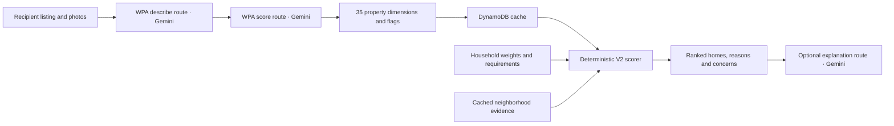
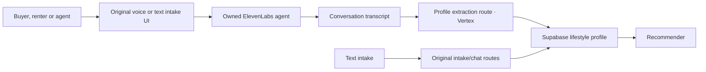

# Workflows

## Property analysis and fit

`src/lib/recommender/orchestratorV2.ts` runs prefiltering, neighborhood lookup, a bounded WPA shortlist and fit scoring. The description route reasons about a property; the score route structures that description. `fitScoringV2.ts` consumes that structured evidence and a household profile. The household can change without regenerating property analysis.

The current scorer has 35 property dimensions and four neighborhood weight mappings: quietness, safety, digital-nomad fit and family fit. Historical plans describe a broader 20-dimension neighborhood model. That larger data model is distinct from the four contributions actually consumed here.

The pre-WPA budget/location/size/bedroom stage is a soft score. The fit stage handles known must-have thresholds, selected property dealbreakers and household-relevant safety flags, then calculates a weighted mean, applies standouts/concerns/confidence adjustments and clamps to 0–100. Null dimensions are omitted. The output includes a score, pass/fail, reason, contribution breakdown, top matches and concerns.

The first-result command runs those deterministic stages against authored cached-analysis-shaped objects. Cloud reads, photo inference and explanation generation are separate provider acceptance.

## Voice and text intake

`VoiceIntake`, `IntakeChat`, `/recommend/intake` and `SpeakWithLeoContent` preserve the original voice-first product. The latter has distinct renter/buyer intake, what-if and follow-up roles; some original roles shared an agent identity. Recipient environment fields now replace those identities. The exported agent configurations retain the prompts and tools across original versions.

## Location and commute

Life profiles carry work location, commute constraints, household needs and tradeoffs. The source contains H3/DynamoDB neighborhood lookup, Geoapify-based lifestyle calculation, self-hosted Nominatim adapters, map rendering and several geographic/heatmap experiments.

`sweetSpot.ts` is explicitly an MVP sample location engine. Its release examples use fictional neighborhoods, purchase rates and commute minutes. The generated Barcelona SVG studies are historical schematic demonstrations driven by their source generators. They are distinct from a recipient’s licensed live map and measured route durations. A citywide production commute acceptance is still open.

## Catalogue ingestion

Agency-specific harvesters, extraction rules, Lambda orchestration, S3 HTML storage, DynamoDB adapters and catalogue export remain in source. They depend on recipient-owned infrastructure and independently authorized listing/photo acquisition. Historical agency URLs describe adapter targets; a source release grants Peter’s code, while third-party site/data rights retain their owners.

## Property reports and renovation

The full app also retains property-analysis, room/layout, renovation, report and what-if components. These share source lineage with the separate renovation-estimates product. Their cloud tables, provider generation, private evidence and pricing indices are outside the first-match proof. Follow the source reference to reuse a component without conflating its design screen with a tested provider workflow.
